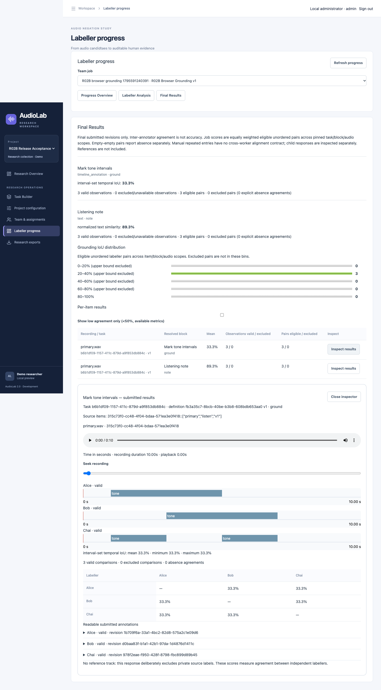

# AudioLab

AudioLab is an audio annotation platform for audio and multimodal AI research.
Researchers define versioned forms, import their own recordings, assign independent
labellers and retrieve reproducible submitted results with provenance. Dataset
originals and reference labels remain separate from human submissions.

**AudioLab v1.0.0** · [Apache License 2.0](LICENSE) Local, hosted CI and real
Cloudflare workers.dev staging acceptance have passed. Live staging verified email
OTP for one administrator and one labeller, private D1/R2, HTTPS CLI ingestion,
Chrome annotation/playback, Final Results and JSON/ZIP exports. Three-labeller
agreement was verified locally and in hosted CI; it is not a three-labeller live
Cloudflare claim. See [license and asset scope](docs/LICENSE_STATUS.md).

## Documentation

- **Local and Cloudflare deployment:** [install, initialize and restart](docs/22_FRESH_LOCAL_SETUP.md), [deploy, back up and recover](docs/DEPLOYMENT.md).
- **Datasets and labellers:** [canonical JSON, original answers and CLI](docs/23_DATASET_INGESTION.md), [accounts, teams and allocation](docs/WORKFLOW.md), [production identities](docs/AUTHENTICATION.md).
- **Requirements, backend and database:** [prerequisites and migrations](docs/22_FRESH_LOCAL_SETUP.md), [architecture](docs/ARCHITECTURE.md), [API contracts](docs/API.md), [tests/CI](docs/TESTING.md).
- **Features and concepts:** [annotation walkthrough](docs/WORKFLOW.md), [results/IoU/export](docs/RESULTS.md), [known limitations](docs/KNOWN_LIMITATIONS.md).

[Proposed release notes](RELEASE_NOTES.md) · [Release checklist and packaging](docs/RELEASING.md).

## Routine administration

Existing manifest-driven CLIs automate routine dataset and account work:

| Operation | Local | Cloudflare |
| --- | --- | --- |
| Import/validate/retry a dataset | `scripts/import_dataset.py --auth local` | Same CLI with `--auth access --access-token-file ...` |
| Add labellers in batches | `scripts/import_labellers.py` (up to 200; generated private passwords) | `scripts/provision_access.py` (up to 50; verified Access subjects, no passwords) |
| Grant teams/work | Team & assignments after account/project provisioning | Same UI after Access allowlisting and account linking |

[Complete custom JSON/audio example and exact commands](docs/23_DATASET_INGESTION.md#complete-custom-example-same-files-local-or-cloudflare) ·
[Local/cloud batch provisioning and revocation](docs/AUTHENTICATION.md#batch-labeller-operations-local-and-cloudflare).
Cloudflare email OTP verifies each new person once; operator batches create their
explicit AudioLab account/project links. This release has no public signup,
self-service invitation or dataset-import UI.

## Research workflows

- Sound classification/negation: Boolean, single choice and multiple choice.
- Temporal grounding: labelled intervals, tiers, TextGrid and audio slots.
- Speech: text/transcript and optional timed grounding; no automatic ASR.
- Preference: ranking and ordered audio comparisons.
- Structured studies: numeric/rating fields and manual repeated groups.

Project roles, immutable published definitions, pinned inputs, frozen allocations
and append-only revisions preserve the research trail. The workspace supports
autosave, reload/resume and independent finals. Progress distinguishes recordings,
assignments and submissions; Final Results provide per-question voting, separate
pooled classification counts, rank-position frequencies, original-answer matching,
descriptive statistics and temporal IoU. Optional word/phone/sound grounding aids
can support listening without requiring an answer. Original-answer previews need
explicit training configuration; training responses are not blind evaluation. Exports preserve raw answers and metrics.



The verified ten-second fixture gives IoU **1/3 for all three unordered pairs**.
Agreement is not ground-truth accuracy. [Metrics](docs/RESULTS.md) ·
[Workspace screenshot](docs/images/grounding-workspace.png) ·
[Task Builder screenshot](docs/images/task-builder.png).

## Demonstration video

A demonstration has been recorded. Its public video link will be added when
available. Until then, the synthetic-data screenshots above and the
[step-by-step demonstration guide](docs/DEMONSTRATION.md) show the workflow.

## Architecture

React/TypeScript → Vinext/Vite → Cloudflare Worker API → authentication/project
authorization → Zod validation → services → SQL repositories → D1. Private R2
audio streams through authorized Worker endpoints. Shared contracts connect the
Builder, workspace, analytics and export. Dataset ingestion remains a Python CLI.
[Architecture](docs/ARCHITECTURE.md) · [API reference](docs/API.md).

## Quick start

Prerequisites: **Node 24**, **pnpm 11.25.0**, **Python 3.10+** (3.11 tested),
venv/pip, and an OS supported by Cloudflare's local workerd runtime. Internet is
needed for dependencies; no cloud account is needed locally. Use an approved
source checkout and a new persistence root, without copied demonstration data.

```sh
git clone https://github.com/PeterLOVANAS/AudioLab.git AudioLab
cd AudioLab
pnpm install --frozen-lockfile
python3.11 -m venv .venv
. .venv/bin/activate
python -m pip install -r scripts/requirements.txt

WORK="$(mktemp -d -t audiolab-local)"
export WORK
export AUDIOLAB_LOCAL_STATE="$WORK/state"
export AUDIOLAB_BASE_URL=http://127.0.0.1:5173
export AUDIOLAB_ENV=local
python scripts/init_local.py --state-root "$AUDIOLAB_LOCAL_STATE" \
  --initialize --server-stopped --username local-admin \
  --project-name "Listening study" --project-slug listening-study
AUDIOLAB_AUTH_MODE=demo pnpm exec vite dev --host 127.0.0.1 --port 5173 --strictPort
```

The initializer refuses an existing root, applies local migrations and provisions
one admin/project. Read its private `admin-credentials.json` locally and sign in at
the exact origin above; never record/share the password. Choose a new durable
directory outside the repository for real work; temporary storage is not a backup.

In a second terminal activate the same venv and export the **same** `WORK`, state
and origin. Import the bundled **CC0** example:

```sh
PROJECT_ID="$(python -c 'import json,os; print(json.load(open(os.environ["AUDIOLAB_LOCAL_STATE"]+"/environment.json"))["projectId"])')"
export PROJECT_ID
python scripts/import_dataset.py --base-url "$AUDIOLAB_BASE_URL" \
  --project-id "$PROJECT_ID" --create-dataset "Synthetic tones" --dataset-version v1 \
  --adapter canonical --manifest examples/datasets/synthetic/manifest.json \
  --root examples/datasets/synthetic/audio \
  --credentials-file "$AUDIOLAB_LOCAL_STATE/admin-credentials.json" \
  --output "$WORK/import-plan" --import
```

[Installation/troubleshooting](docs/22_FRESH_LOCAL_SETUP.md) ·
[Custom dataset ingestion](docs/23_DATASET_INGESTION.md) ·
[Complete synthetic walkthrough](docs/WORKFLOW.md).

## Annotate and retrieve results

1. Select the project; in Task Builder also choose **Save to project** explicitly.
2. Select dataset/source fields, configure blocks, save and publish a version.
3. Provision independent labellers and a team. Review the job's selected people,
   items and published version; preview then confirm allocation.
4. Each labeller signs in, opens their assigned job/recording, listens, annotates,
   saves/reloads and submits. Finals are read-only; earlier drafts remain.
5. Inspect Progress Overview/Labeller Analysis. Final Results unlock after all
   assignments submit. Research exports offers JSON, per-audio JSON ZIP and JSON
   plus annotated WAV ZIP. Partial exports include available finals only.

## Deployment, testing and contribution

- [Deployment](docs/DEPLOYMENT.md) and [authentication](docs/AUTHENTICATION.md):
  actual Vinext/cf commands, D1/private R2, Access, controlled identity linking,
  migration/backup and staging requirements. No public signup or machine-token
  ingestion. `pnpm run deploy --check` validates configuration; actual deployment
  requires separate authorization.
- [Testing/CI](docs/TESTING.md): typecheck, regressions, Python, build, production
  HTTP/TLS and disposable browser acceptance commands.
- [Contributing](CONTRIBUTING.md), [security reporting](SECURITY.md),
  [acknowledgements](ACKNOWLEDGEMENTS.md), [third-party notices](THIRD_PARTY_NOTICES.md)
  and [change history](CHANGELOG.md).

## Known limitations

PCM WAV ingestion is limited to 10 MiB/file. Original-answer matching supports
unambiguous choice references from current imported sources; it is separate from
agreement and does not imply pinned historical ground truth. No adjudication,
workflow engine, import UI, automatic ASR or kappa/WER/CER promise. Manual repeated
rows lack cross-worker alignment. Acoustic displays are estimates. Human audible
output on other systems, broader browser/load testing and three-labeller live
acceptance remain outside the verified scope. [Detailed limits](docs/KNOWN_LIMITATIONS.md).

