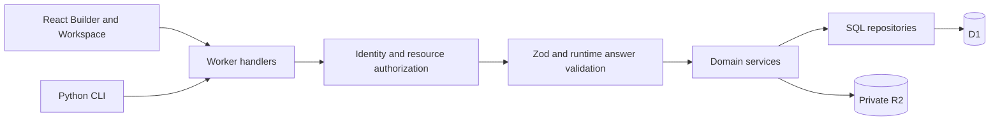

# Architecture and persisted research data

React/TypeScript runs through Vinext/Vite and a Cloudflare Worker; this is not a
separate Express server or conventional Next.js deployment.
[Vite configuration](../vite.config.ts) selects Vinext and the Cloudflare plugin;
[Cloudflare configuration](../cloudflare.config.ts) declares D1, private R2,
static assets and Images bindings.

[proxy.ts](../proxy.ts) and [authorizeApi](../lib/backend/auth/api-guard.ts)
enforce session, project roles, resource ownership, actor equality and same-origin
writes before handlers. UI visibility is not authorization. Routes under
`app/api/v1/` parse HTTP; validators check shape and resolved answer semantics;
services coordinate domain models; repositories use bound SQL and D1 constraints.
[Authentication](AUTHENTICATION.md) · [API](API.md).

| Entity | Persisted relationship/invariant |
| --- | --- |
| Project | Membership/role boundary; accounts may join several projects |
| Dataset | Project-owned named/versioned corpus registration |
| Audio Asset | Dataset-owned R2 object, stable ID, path/hash/timing metadata |
| Source Record | Stable external sample/item/version content linked to audio; original/reference labels stay separate |
| Task Definition | Project-owned editable draft with optimistic revision |
| Published version | Immutable definition snapshot; draft edits never change older versions |
| Task Instance | Pins published version, ordered audio slots and worker-safe input snapshot |
| Team | Eligible project labellers/profiles; not an authentication role |
| Annotation Job | Frozen items/workers/version/seed/allocation plan |
| Assignment | One real labeller's allocated Task Instance; ownership checked server-side |
| Annotation Revision | Append-only draft/final answer map and expected prior revision |
| Final Results | Derived read of immutable finals and resolved scopes; no second persistence model |
| Research Export | Admin snapshot of finals, raw/readable answers, provenance and the same authoritative analytics |

Shared `lib/contracts/` DTOs connect frontend/backend. Builder configuration is in
`components/task-builder/model.ts`. `lib/backend/services/task-inputs.ts` pins
worker-safe sources; runtime binding helpers resolve the published blocks used by
answer validation. Private references are filtered before ordinary worker serialization. Explicit
choice-training opt-in pins only a deliberately released answer in new task inputs;
this does not change source visibility or expose other private metadata. Builder
uses a separate administrator preview projection; assigned tasks resolve server-pinned
inputs. Original-answer matching is admin-only and reads current imported references,
whereas agreement reads immutable submitted revisions.

Local emulation uses an explicit new persistence root. Production uses bindings.
The runtime migration set contains 16 files under `migrations/`; 0010 is reserved
for a historical branch. The attributed compatibility fixture outside that
directory is only in-memory test input, not a workflow engine or new migration.

`result-analytics.ts` implements deterministic metrics, `job-results.ts` aggregates
persisted finals, and Research Export reuses that service. The frontend renders
authoritative values. [Results and export](RESULTS.md).
